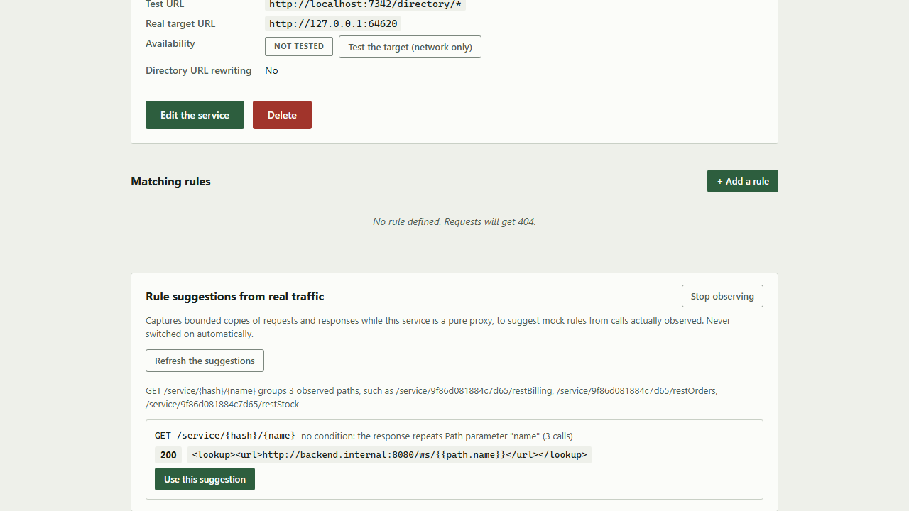

[Français](../fr/traffic-observation.md)

# Traffic observation and rule suggestions

For a service in **pure proxy** mode (not mocked at all yet), Mimicway can watch the traffic really exchanged with the real backend and **suggest mock rules** from what it saw, instead of having you write them all by hand. Nothing starts by itself: you turn it on explicitly, service by service.

## Turning observation on

On the page of a service **in proxy mode** (`is_mocked` off), the "Rule suggestions from real traffic" panel offers **"Observe this service"**. Once clicked, Mimicway captures (within bounds, see "Limits" below) the request and the response of each call relayed to the real backend, as long as observation stays on.

This changes **nothing** in how the proxy behaves (the request is still relayed as it is): it only adds a capture on the side, which you can turn off at any time.

## The trap Mimicway avoids

Two calls to the same endpoint (same method, same path) can legitimately get different answers: a parameter, a header or an identifier that changes also changes the real backend's answer. A rule generated naively from the **first** call seen would silently break every other case.

Mimicway therefore waits until it has seen **several calls** to a route (see the next section) before suggesting anything, then:

- When every observed response is the same, it suggests a rule **without conditions**.
- When the responses vary and a path parameter, a query parameter, a JSON body field or a header **predicts exactly** which response comes back for which value, it suggests **one rule per value**, each with its condition.
- When the responses vary **and no field explains it reliably**, it suggests no rule. A message reports the variance, rather than a rule that would silently break some calls.

## Paths grouped into routes

Calls that differ only by an identifier, such as `/orders/1` and `/orders/2`, are one route for Mimicway: it groups them under a pattern, `/orders/{id}`, and suggests rules for the pattern, which match every such path. A part of the path becomes a parameter in two cases:

- It looks like an identifier: a number or a date, a UUID, a hexadecimal hash, a long code mixing letters and digits. One call is enough, since a rule written for a single identifier rarely outlives the session it was observed in.
- At least two different words at the same place are answered with documents of the same structure (same status and media type, same JSON keys or same XML elements), as a service directory answers for each service it knows: `/directory/restOrders` and `/directory/restStock` become `/directory/{name}`. Words answered with documents of different structures, such as `/orders` and `/customers`, stay two routes, and so do words answered in plain text.

The minimum number of calls applies to the route, not to each path: three calls to three different orders are enough. Each suggestion names its pattern and a few of the paths it groups.

The pattern's parameters are the first fields Mimicway tries to explain the responses with. When each order gets its own answer, it suggests one rule per order, with a condition on `{id}`. When the responses differ **only** by the value that tells them apart, because the backend repeats it (a directory answering `http://backend/ws/restOrders` for `restOrders`), it suggests a **single** rule whose response repeats that value through an expression such as `{{path.name}}`, so that it also answers the values it never saw. The text around the expression is the observed response as it was; the expression is the only template in it.

A literal path next to a pattern, such as `/users/me` next to `/users/{id}`, is suggested first: rules apply in their order, and the more specific one must come first.

## Using a suggestion

**"Refresh the suggestions"** reads the traffic observed since observation was turned on and computes the suggestions again (nothing refreshes in the background). **"Use this suggestion"** does **not** create the rule: it fills the usual rule form (method, sub-path, condition, response), so that you review, adjust and save it like any other rule.

## Requirements and limits

- Only for a service in **pure proxy** mode (`is_mocked` off): "Observe this service" is refused otherwise, since observation only makes sense on traffic relayed to a real backend.
- A call is captured only when the sizes of its request and response are known in advance (a `Content-Length` header, or no body). A response streamed in chunks (`Transfer-Encoding: chunked`, no announced size) is still relayed normally but not observed.
- A path of more than 32 segments is not suggested.
- The number of observations kept is bounded, per path and overall (see the `TRAFFIC_OBSERVATION_*` settings in the README): beyond that, the oldest are replaced by the newest, so memory never grows without limit.
- Credentials are never captured: `Authorization`, cookies, API-key headers and any header listed in `REDACT_HEADERS` are kept as `[redacted]`, and suggested rules never copy them.
- Observation stops by itself when its service is deleted, renamed or moved to another group, and on every full reset of the configuration. What it observed is then forgotten, as when you stop observing: observing again starts from nothing, and a service created later under the same name never inherits another one's traffic.
- Like the [request log](request-log.md), nothing is written to disk: a restart of Mimicway starts with no observation.
