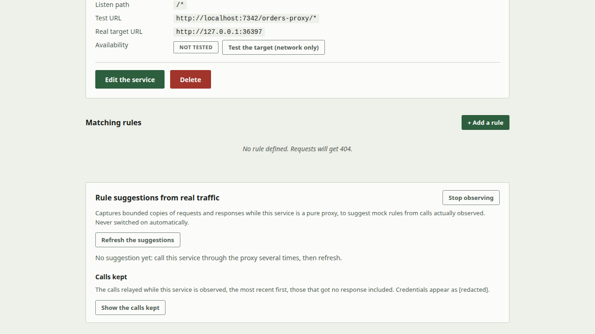

[Français](../fr/traffic-observation.md)

# Traffic observation and rule suggestions

For a service in **pure proxy** mode (not mocked at all yet), Mimicway can watch the traffic really exchanged with the real backend and **suggest mock rules** from what it saw, instead of having you write them all by hand. Nothing starts by itself: you turn it on explicitly, service by service.

## Turning observation on

On the page of a service **in proxy mode** (`is_mocked` off), the "Rule suggestions from real traffic" panel offers **"Observe this service"**. Once clicked, Mimicway captures (within bounds, see "Limits" below) the request and the response of each call relayed to the real backend, as long as observation stays on.

This changes **nothing** in how the proxy behaves (the request is still relayed as it is): it only adds a capture on the side, which you can turn off at any time.

## The trap Mimicway avoids

Two calls to the same endpoint (same method, same path) can legitimately get different answers: a parameter, a header or an identifier that changes also changes the real backend's answer. A rule generated naively from the **first** call seen would silently break every other case.

Mimicway therefore waits until it has seen **several calls** to a route (see the next section) before suggesting anything, then:

- When every observed response is the same, it suggests a rule **without conditions**.
- When the responses vary and a path parameter, a query parameter, a field of the body or a header **predicts** which response comes back (each of its values always gets the same response), it suggests **one rule per response**, with its condition. A response reached by several values, such as a directory giving the same address for two names, gets one rule that accepts any of them ("any of" conditions).
- When the responses vary **and no field explains it reliably**, it suggests no rule. A message reports the variance, rather than a rule that would silently break some calls.

When several fields would explain the responses, Mimicway keeps the one with the **fewest different values**: the name that decides wins over an identifier that changes at every call. Repetition is the evidence: a field explains the responses only when **each of its values was seen at least twice**, always with the same response; a value seen once fits any sample, as an identifier unique to each call (a message identifier in a SOAP header) would. One exception keeps the suggestions of earlier versions: a path parameter, a query parameter or a field at the top of a JSON object may explain the responses with values seen once when each response has its own value.

A call answered with a **server error** (a `5xx` status) that no field explains is set aside: Mimicway suggests the rules for the other calls, if there are still enough of them and more of them than of errors, and the suggestion says how many calls were left out and with which status. Five identical answers and one `500` give one rule for the five; three answers and fifty `503` give none, since errors are what that route mostly does.

## Paths grouped into routes

Calls that differ only by an identifier, such as `/orders/1` and `/orders/2`, are one route for Mimicway: it groups them under a pattern, `/orders/{id}`, and suggests rules for the pattern, which match every such path. A part of the path becomes a parameter in two cases:

- It looks like an identifier: a number or a date, a UUID, a hexadecimal hash, a long code mixing letters and digits. One call is enough, since a rule written for a single identifier rarely outlives the session it was observed in.
- At least two different words at the same place are answered with documents of the same structure (same status and media type, same JSON keys or same XML elements), as a service directory answers for each service it knows: `/directory/restOrders` and `/directory/restStock` become `/directory/{name}`. Words answered with documents of different structures, such as `/orders` and `/customers`, stay two routes, and so do words answered in plain text.

The minimum number of calls applies to the route, not to each path: three calls to three different orders are enough. Each suggestion names its pattern and a few of the paths it groups.

The pattern's parameters are the first fields Mimicway tries to explain the responses with. When each order gets its own answer, it suggests one rule per order, with a condition on `{id}`. When the responses differ **only** by the value that tells them apart, because the backend repeats it (a directory answering `http://backend/ws/restOrders` for `restOrders`), it suggests a **single** rule whose response repeats that value through an expression such as `{{path.name}}`, so that it also answers the values it never saw. The text around the expression is the observed response as it was; the expression is the only template in it.

A literal path next to a pattern, such as `/users/me` next to `/users/{id}`, is suggested first: rules apply in their order, and the more specific one must come first.

## SOAP operations and fields of the body

Every operation of a SOAP service is a `POST` to the same address: what tells two calls apart is the element the `Body` of the envelope holds. When every call of a route names **one** operation, Mimicway suggests rules **per operation**: each suggestion names its operation, and each of its rules carries the condition `Envelope/Body/<operation>` exists, in the syntax of XPath conditions (namespace prefixes are ignored), so that it never answers another operation. A route where one call names no operation, or several, is not split. Observation keeps the calls of each operation apart, as it does for each path: one busy operation never pushes the calls of the others out.

Inside an operation, and for any body, the fields of the body are tried like the other fields of the request:

- in an XML body, the text of each element that holds no other element, read at the first element of its path, as an XPath condition reads it (`Envelope/Body/getStatus/ref`); a CDATA section is read as text;
- in a JSON body, each string, number or boolean at any depth, as a JSON pointer (`/order/shipping/kind`).

A rule suggested from such a field matches the calls it was drawn from: the field is read as the condition written from it reads the request. Reading a body is bounded: the first 64 fields of a body, 16 levels deep at most, a path of 256 bytes and a value of 256 bytes at most; anything beyond gives no field. A request body cut at the size limit of observation (`TRAFFIC_OBSERVATION_MAX_BODY_SIZE`) gives no field and no operation, and the suggestion says how many bodies were cut: raise that setting when a field you expect is never used. A request body in another encoding than UTF-8 (a SOAP envelope declared `ISO-8859-1`, say) gives no field and no operation either, and the suggestion counts those bodies: the conditions of a rule read the bytes the mock receives, and an XPath condition reads only UTF-8.

## Responses that repeat the request

Many operations answer with what they were asked: the reference of the request, its dates, each line of a list. One rule per value seen would answer a request never seen with the values of another one. When the responses of a route (or of an operation) differ **only** where they repeat values of their own request, Mimicway suggests a **single** rule without condition whose response reads each value from the request:

- **Values**: a path or query parameter, a header, a field of an XML or JSON body. The response keeps the observed text and holds an expression where each value stands, for instance `{{xpath.Envelope/Body/GetStatus/ref | xml_text}}` or `{{body./order/ref | json_string}}`, its pipe chosen by where the value stands in the document (the text of an element, an attribute, a CDATA section, a JSON string), not by the values observed: any value to come keeps the response well formed. A value that stands where no escaping can promise that (out of any JSON string, inside a tag or a comment) is not generalized. Several fields can be repeated at once. A field whose value was the same in every call stays as written: nothing shows that the response repeats it.
- **Lists**: when the request holds a repeated element (`<slot>` elements, a JSON array of objects) and the response a block per item, each block being the same text around values of the item of the same rank, the suggested rule comes with a **script** that reads the items (`parse_xml_items`, `parse_json`) and writes one block per item, each value escaped for where it stands (`xml_text`, `xml_attr`, `cdata`, `json_string`; out of a JSON string, the JSON value of the request itself, `to_json`, `null` for a field missing); the response reads the result with `{{script.items}}`. A request with no item gets the text around the list alone. "Use this suggestion" fills the form with the script, switched on, and the advanced template.

The panel names, in plain words, the fields the response repeats and the list it writes one block per item of.

The guarantee: such a rule is suggested only if, rendered by Mimicway itself (templates and script) for each observed request, it gives back the observed response **byte for byte**; otherwise you get the suggestions described above, one rule per value. Text observed in a response never becomes a template nor code: it stays in literal fragments of the response, or in string literals of the script, escaped.

Limits: values of 256 bytes at most, 64 per response; one list per response, two calls with items at least, and items of 32 fields at most. The script runs within the limits of any script, and the rule says the most items it writes (`max_items`, shown in the panel), measured on requests built like the observed ones: 250 items of two fields in an XML request, which reads 500 fields at most. A larger list observed gives no such rule; at run time, past that number, the response holds the text around the list without its blocks. The format of a response comes from its content type, confirmed by reading it whole; a body that no JSON or XML reader accepts is text, whose values are written as they are.

## Using a suggestion

**"Refresh the suggestions"** reads the traffic observed since observation was turned on and computes the suggestions again (nothing refreshes in the background). **"Use this suggestion"** does **not** create the rule: it fills the usual rule form (method, sub-path, conditions, response), so that you review, adjust and save it like any other rule.

Through the API, `GET /api/services/{name}/suggestions` gives one entry per route (or operation), whose `outcome` is `Unconditional`, `Echo` or `Conditional` exactly as in version 0.5.0 (each rule says everything with its `condition` and `echo`), `VarianceUnexplained`, or `Rules` for what 0.5.0 could not say: an operation, calls set aside, a rule of several conditions or of "any of" conditions, a response that repeats several values or a list. The rules of `Rules` are read by their `conditions`, `response` and `script`; a client written for 0.5.0 does not know that outcome and leaves it aside, rather than create rules without their conditions.

## Following the services a response points to

Many backends answer with the addresses of others: a service directory giving the address of each service it knows, links between resources, a redirect, the address in a WSDL. The application then calls those addresses **directly**, past Mimicway, where they can be neither observed nor mocked.

After a refresh, the panel lists under **"Backends named in the responses"** each backend the observed responses point to, by origin (`http://host:port`), with the routes that named it and an example address. Mimicway looks in the bodies and in the `Location`, `Content-Location` and `Link` headers, and leaves out XML namespace and schema addresses (`xmlns`, `targetNamespace`, `xsi:schemaLocation`) and Mimicway's own address.

1. For a backend that no service reaches yet, **"Create a proxy service in front of it"** opens the usual service form, filled with a name taken from the host and the origin as target, in the observed service's group. Nothing is created until you save it, through the usual checks.
2. Back on the observed service, **refresh the suggestions**. In the suggested rules, every address of a backend that a service of Mimicway reaches (its target is the start of the address, and its listen path accepts the rest) now points to that service in Mimicway; each rule says which services it sends the application to.
3. Once the directory is mocked with that rule, the application it serves calls Mimicway, whose new proxy service can be observed in turn, and so on down the chain.

The address of Mimicway is written in the body as `{{header.x-forwarded-proto | default("http")}}://{{header.host}}`, followed by the service's path and the rest of the observed address as it was: the rule answers with the address the application used to reach Mimicway, whatever its host name and port. Headers are never templates, so a `Location` or `Link` header gets the address Mimicway was reached at while observing.

A rule whose script writes a list cannot send the address it writes elsewhere: when its blocks name a backend that a service of Mimicway reaches, the suggestion is the one without the list (one rule per value, or none), whose texts are rewritten as above.

Only the **suggested rules** are rewritten. The traffic Mimicway relays is never changed: while it is a proxy, the directory still answers the real addresses.

## Reading the calls kept

What observation kept can be read call by call, not only through the rules it suggests. Under the suggestions, **"Show the calls kept"** lists the calls relayed while the service is observed, the most recent first: the time, the method, the path with its query, and the backend's status, or why no response came. **"Details"** opens a call in place: its request (method, path, query, headers, body) and the backend's response (status, headers, body). As for the suggestions, nothing refreshes in the background: **"Refresh the calls"** reads the list again.

A relay that fails is kept too, with its request: when the backend is stopped, does not answer in time, cuts its response short, or when the target is outside `PROXY_ALLOWED_TARGETS`, the caller gets `502` (or `504` after a timeout), and the call shows the request as it was sent, the reason in plain words, the target Mimicway aimed at and the error of the network in its own words. These calls are kept in a list of their own (`TRAFFIC_OBSERVATION_MAX_FAILED_CALLS`, across all observed services), so that a backend that stays down never pushes the good samples out, and they **never** feed a suggestion: a `502` written by Mimicway is not an answer of the backend.

An open call can be sent again by hand:

- **"Copy the command"** copies a `curl` command, for a POSIX shell (sh, bash, zsh), that sends the same request to Mimicway, at the address of the page, which relays it to the backend: once the backend is back, the command replays the call, and observation keeps the replay. The command is shown above the button, to select by hand where the browser cannot copy (a page served over plain HTTP from another machine). Every value is quoted for the shell, whatever it holds (quotes, `$`, backticks, line breaks, any language).
- **"Download the request body"** saves the body as it was kept.

What the command and the file cannot hold, the screen says:

- a credential header is kept as `[redacted]`, and stays so in the command: put the real value back before running it;
- a body cut at `TRAFFIC_OBSERVATION_MAX_BODY_SIZE` is shown as cut, with its real size and the setting to raise; the command sends the part kept;
- a body in another encoding than UTF-8 is kept as text, each byte that is not UTF-8 replaced: what is shown, copied and downloaded is not the original byte for byte;
- a body holding a NUL character cannot be written in a command line: the command reads it from the downloaded file.

Through the API, `GET /api/services/{name}/observed-calls` (or `/api/groups/{group}/services/{name}/observed-calls`) lists the calls, each with its `id`, and `GET …/observed-calls/{id}` gives one whole (`request`, then `response`, or `failure` with its `cause`: `refused_target`, `unreachable`, `timeout`, `interrupted` or `other`). Both ask for the same right on the service as its suggestions.

## Requirements and limits

- Only for a service in **pure proxy** mode (`is_mocked` off): "Observe this service" is refused otherwise, since observation only makes sense on traffic relayed to a real backend.
- A call is captured only when the sizes of its request and response are known in advance (a `Content-Length` header, or no body). A response streamed in chunks (`Transfer-Encoding: chunked`, no announced size) is still relayed normally but not observed.
- A path of more than 32 segments is not suggested.
- The number of observations kept is bounded, per path (per operation for a SOAP address) and overall (see the `TRAFFIC_OBSERVATION_*` settings in the README): beyond that, the oldest are replaced by the newest, so memory never grows without limit. At most 32 operations of one path are kept apart; the calls of any further operation share the path's own place.
- A request whose body is too large to buffer (`TRAFFIC_OBSERVATION_MAX_BUFFER_SIZE`) or of unknown size is relayed as it comes and not kept, whether its relay succeeds or fails.
- Failed relays are bounded apart from the exchanges (`TRAFFIC_OBSERVATION_MAX_FAILED_CALLS`, 100 by default, across all observed services): beyond that, the oldest goes first.
- A call keeps one value per header name, and leaves out a header whose value is not plain ASCII text.
- Credentials are never captured: `Authorization`, cookies, API-key headers and any header listed in `REDACT_HEADERS` are kept as `[redacted]` before anything is kept, and suggested rules and copied commands never hold them. **Not redacted**: a credential carried in the query string (`?api_key=…`) or in a body (a password in a SOAP envelope), and a header that carries one under a name the list does not know (add it to `REDACT_HEADERS`). Whoever may read the service's suggestions reads them in its calls.
- Observation stops by itself when its service is deleted, renamed or moved to another group, and on every full reset of the configuration. What it observed is then forgotten, as when you stop observing: observing again starts from nothing, and a service created later under the same name never inherits another one's traffic.
- Like the [request log](request-log.md), nothing is written to disk: a restart of Mimicway starts with no observation.
