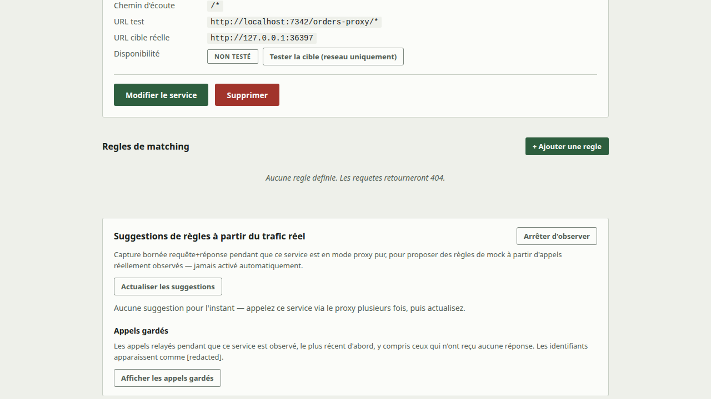
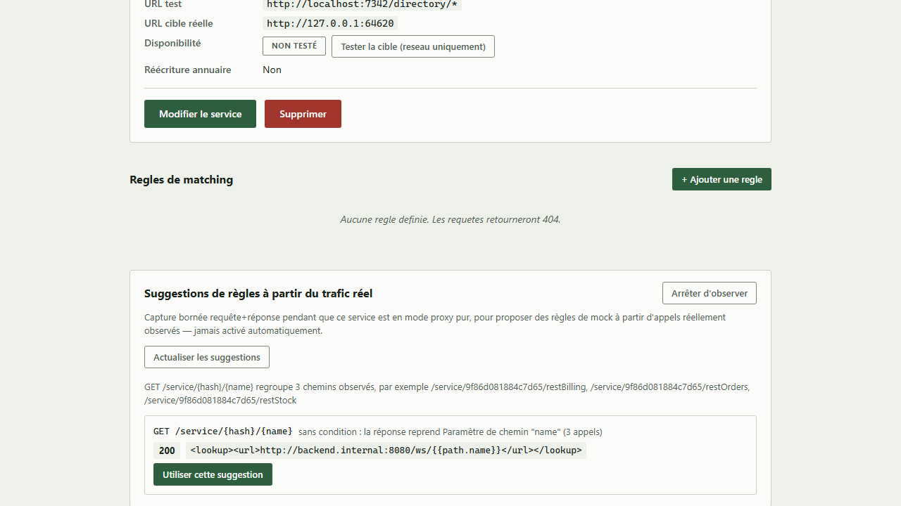
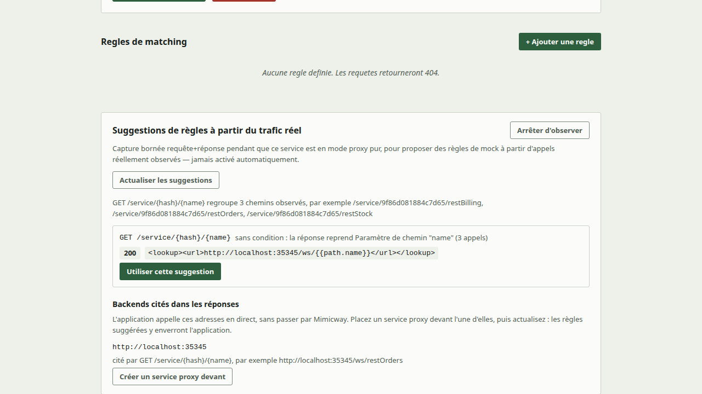

[English](../en/traffic-observation.md)

# Observation de trafic et suggestions de règles

Pour un service en mode **proxy pur** (pas encore simulé du tout), Mimicway peut observer le trafic réellement échangé avec le vrai backend et **proposer des règles de mock** à partir de ce qu'il a vu, au lieu de vous les faire toutes écrire à la main. Rien ne démarre tout seul : vous l'activez explicitement, service par service.

## Activer l'observation

Sur la page d'un service **en mode proxy** (`is_mocked` désactivé), le panneau « Suggestions de règles à partir du trafic réel » propose **« Observer ce service »**. Une fois ce bouton cliqué, Mimicway capture (dans certaines limites, voir « Limites » plus bas) la requête et la réponse de chaque appel relayé au vrai backend, tant que l'observation reste active.

Cela ne change **rien** au comportement du proxy (la requête est toujours relayée telle quelle) : une capture s'ajoute seulement à côté, et vous pouvez l'arrêter à tout moment.

## Le piège que Mimicway évite

Deux appels au même point d'accès (même méthode, même chemin) peuvent légitimement recevoir des réponses différentes : un paramètre, un en-tête ou un identifiant qui change modifie aussi la réponse du vrai backend. Une règle générée naïvement à partir du **premier** appel vu casserait silencieusement tous les autres cas.

Mimicway attend donc d'avoir vu **plusieurs appels** à une route (voir la section suivante) avant de proposer quoi que ce soit, puis :

- Quand toutes les réponses observées sont identiques, il propose une règle **sans condition**.
- Quand les réponses varient et qu'un paramètre de chemin, un paramètre de requête, un champ du corps ou un en-tête **prédit** quelle réponse revient (chacune de ses valeurs reçoit toujours la même réponse), il propose **une règle par réponse**, avec sa condition. Une réponse atteinte par plusieurs valeurs, comme un annuaire qui donne la même adresse pour deux noms, reçoit une seule règle qui accepte chacune d'elles (conditions « au moins une »).
- Quand les réponses varient **et qu'aucun champ ne l'explique de façon fiable**, il ne propose aucune règle. Un message signale la variation, plutôt qu'une règle qui casserait silencieusement certains appels.

Quand plusieurs champs expliqueraient les réponses, Mimicway garde celui qui a **le moins de valeurs différentes** : le nom qui décide l'emporte sur un identifiant qui change à chaque appel. Un champ dont chaque valeur n'a été vue qu'une fois, et qui demanderait plusieurs valeurs pour une même réponse, n'est jamais choisi : n'importe quel identifiant propre à chaque appel conviendrait, il ne prouve donc rien.

Un appel qui a reçu une **erreur du serveur** (un statut `5xx`) qu'aucun champ n'explique est mis de côté : Mimicway propose les règles des autres appels, s'il en reste assez, et la suggestion dit combien d'appels ont été écartés et avec quel statut. Cinq réponses identiques et un `500` donnent une règle pour les cinq.

## Chemins regroupés en routes

Des appels qui ne diffèrent que par un identifiant, comme `/orders/1` et `/orders/2`, forment une seule route pour Mimicway : il les regroupe sous un modèle, `/orders/{id}`, et propose des règles pour ce modèle, qui correspondent à tous ces chemins. Une partie du chemin devient un paramètre dans deux cas :

- Elle ressemble à un identifiant : un nombre ou une date, un UUID, une empreinte hexadécimale, un long code qui mêle lettres et chiffres. Un seul appel suffit, car une règle écrite pour un seul identifiant survit rarement à la session où il a été observé.
- Au moins deux mots différents au même endroit reçoivent des documents de même structure (même statut et même type de média, mêmes clés JSON ou mêmes éléments XML), comme un annuaire de services répond pour chaque service qu'il connaît : `/directory/restOrders` et `/directory/restStock` deviennent `/directory/{name}`. Des mots qui reçoivent des documents de structures différentes, comme `/orders` et `/customers`, restent deux routes, de même que des mots qui reçoivent du texte brut.

Le nombre minimal d'appels s'applique à la route, pas à chaque chemin : trois appels à trois commandes différentes suffisent. Chaque suggestion indique son modèle et quelques-uns des chemins qu'elle regroupe.

Les paramètres du modèle sont les premiers champs avec lesquels Mimicway tente d'expliquer les réponses. Quand chaque commande reçoit sa propre réponse, il propose une règle par commande, avec une condition sur `{id}`. Quand les réponses ne diffèrent **que** par la valeur qui les distingue, parce que le backend la reprend (un annuaire qui répond `http://backend/ws/restOrders` pour `restOrders`), il propose **une seule** règle dont la réponse reprend cette valeur par une expression comme `{{path.name}}`, si bien qu'elle répond aussi aux valeurs jamais vues. Le texte autour de l'expression est la réponse observée telle quelle ; l'expression est le seul modèle qu'elle contient.

Un chemin littéral voisin d'un modèle, comme `/users/me` à côté de `/users/{id}`, est proposé en premier : les règles s'appliquent dans leur ordre, et la plus précise doit venir d'abord.

## Opérations SOAP et champs du corps

Chaque opération d'un service SOAP est un `POST` vers la même adresse : ce qui distingue deux appels est l'élément que contient le `Body` de l'enveloppe. Quand chaque appel d'une route nomme **une** opération, Mimicway propose des règles **par opération** : chaque suggestion nomme son opération, et chacune de ses règles porte la condition `Envelope/Body/<opération>` existe, dans la syntaxe des conditions XPath (les préfixes d'espaces de noms sont ignorés), si bien qu'elle ne répond jamais à une autre opération. Une route dont un appel ne nomme aucune opération, ou plusieurs, n'est pas découpée. L'observation garde les appels de chaque opération à part, comme pour chaque chemin : une opération très appelée ne chasse jamais les appels des autres.

Dans une opération, et pour tout corps, les champs du corps sont essayés comme les autres champs de la requête :

- dans un corps XML, le texte de chaque élément qui ne contient pas d'autre élément, lu au premier élément de son chemin, comme le lit une condition XPath (`Envelope/Body/getStatus/ref`) ; une section CDATA est lue comme du texte ;
- dans un corps JSON, chaque texte, nombre ou booléen à toute profondeur, sous forme de pointeur JSON (`/order/shipping/kind`).

Une règle proposée à partir d'un tel champ correspond aux appels dont elle vient : le champ est lu comme la condition écrite à partir de lui lit la requête. La lecture d'un corps est bornée : les 64 premiers champs d'un corps, sur 16 niveaux au plus, un chemin de 256 octets et une valeur de 256 octets au plus ; au-delà, aucun champ. Un corps de requête coupé à la taille maximale de l'observation (`TRAFFIC_OBSERVATION_MAX_BODY_SIZE`) ne donne ni champ ni opération, et la suggestion dit combien de corps ont été coupés : augmentez ce réglage quand un champ attendu n'est jamais utilisé.

## Réponses qui reprennent la requête

Beaucoup d'opérations répondent avec ce qu'on leur a demandé : la référence de la requête, ses dates, chaque ligne d'une liste. Une règle par valeur vue répondrait à une requête jamais vue avec les valeurs d'une autre. Quand les réponses d'une route (ou d'une opération) ne diffèrent **que** là où elles reprennent des valeurs de leur propre requête, Mimicway propose une **seule** règle sans condition dont la réponse lit chaque valeur dans la requête :

- **Valeurs** : un paramètre de chemin ou de query, un en-tête, un champ d'un corps XML ou JSON. La réponse garde le texte observé et porte une expression à la place de chaque valeur, par exemple `{{xpath.Envelope/Body/GetStatus/ref}}` ou `{{body./order/ref}}`, suivie des pipes qui échappent la valeur pour le format de la réponse (`replace("&", "&amp;")` et ses pareils en XML, guillemets et barres obliques inverses en JSON), si bien qu'une valeur avec `&` ou un guillemet garde la réponse valide. Plusieurs champs peuvent être repris à la fois. Un champ dont la valeur était la même dans tous les appels reste écrit tel quel : rien ne montre que la réponse le reprend.
- **Listes** : quand la requête porte un élément répété (des éléments `<slot>`, un tableau JSON d'objets) et la réponse un bloc par élément, chaque bloc étant le même texte autour de valeurs de l'élément de même rang, la règle proposée vient avec un **script** qui lit les éléments (`parse_xml_items`, `parse_json`) et écrit un bloc par élément, chaque valeur échappée pour le format de la réponse ; la réponse lit le résultat par `{{script.items}}`. Une requête sans élément reçoit le texte autour de la liste seul. « Utiliser cette suggestion » remplit le formulaire avec le script, activé, et le modèle avancé.

Le panneau nomme, en mots simples, les champs que la réponse reprend et la liste dont elle écrit un bloc par élément.

La garantie : une telle règle n'est proposée que si, rendue par Mimicway lui-même (modèles et script) pour chaque requête observée, elle redonne la réponse observée **octet pour octet** ; sinon vous obtenez les suggestions décrites plus haut, une règle par valeur. Un texte observé dans une réponse ne devient jamais ni modèle ni code : il reste dans des fragments littéraux de la réponse, ou dans des chaînes littérales du script, échappé.

Limites : des valeurs de 256 octets au plus, 64 par réponse ; une liste par réponse, deux appels avec des éléments au moins, et des éléments de 32 champs au plus. Le script tourne dans le budget de tout script (10 000 opérations), qui tient une liste d'une centaine d'éléments de deux champs : une liste plus longue observée ne donne pas une telle règle, et à l'exécution un script hors budget répond le texte autour de la liste sans ses blocs. Une réponse dont les valeurs ne sont pas écrites comme leur format les échappe (dans une section CDATA, par exemple) n'est généralisée que pour les valeurs lues telles quelles.

## Utiliser une suggestion

**« Actualiser les suggestions »** relit le trafic observé depuis l'activation de l'observation et recalcule les suggestions (rien ne s'actualise en arrière-plan). **« Utiliser cette suggestion »** ne crée **pas** la règle : il remplit le formulaire de règle habituel (méthode, sous-chemin, conditions, réponse), pour que vous la relisiez, l'ajustiez et l'enregistriez comme n'importe quelle autre règle.

## Suivre les services qu'une réponse désigne

Beaucoup de backends répondent par les adresses d'autres backends : un annuaire de services qui donne l'adresse de chaque service qu'il connaît, des liens entre ressources, une redirection, l'adresse d'un WSDL. L'application appelle ensuite ces adresses **en direct**, sans passer par Mimicway, qui ne peut alors ni les observer ni les simuler.

Après une actualisation, le panneau liste sous **« Backends cités dans les réponses »** chaque backend que les réponses observées désignent, par origine (`http://hôte:port`), avec les routes qui l'ont cité et un exemple d'adresse. Mimicway cherche dans les corps et dans les en-têtes `Location`, `Content-Location` et `Link`, et laisse de côté les adresses d'espace de noms et de schéma XML (`xmlns`, `targetNamespace`, `xsi:schemaLocation`) ainsi que sa propre adresse.

1. Pour un backend qu'aucun service n'atteint encore, **« Créer un service proxy devant »** ouvre le formulaire de service habituel, rempli avec un nom tiré de l'hôte et l'origine comme cible, dans le groupe du service observé. Rien n'est créé avant que vous l'enregistriez, avec les contrôles habituels.
2. De retour sur le service observé, **actualisez les suggestions**. Dans les règles suggérées, chaque adresse d'un backend qu'un service de Mimicway atteint (sa cible est le début de l'adresse, et son chemin d'écoute accepte le reste) désigne désormais ce service dans Mimicway ; chaque règle dit vers quels services elle envoie l'application.
3. Une fois l'annuaire simulé par cette règle, l'application qu'il sert appelle Mimicway, dont le nouveau service proxy peut à son tour être observé, et ainsi de suite le long de la chaîne.

L'adresse de Mimicway s'écrit dans le corps `{{header.x-forwarded-proto | default("http")}}://{{header.host}}`, suivie du chemin du service et du reste de l'adresse observée, tel quel : la règle répond avec l'adresse par laquelle l'application a joint Mimicway, quels que soient son nom d'hôte et son port. Les en-têtes ne sont jamais des modèles : un en-tête `Location` ou `Link` reçoit l'adresse par laquelle Mimicway était joint pendant l'observation.

Seules les **règles suggérées** sont réécrites. Le trafic que Mimicway relaie n'est jamais modifié : tant qu'il est un proxy, l'annuaire répond toujours les adresses réelles.

## Prérequis et limites

- Seulement pour un service en mode **proxy pur** (`is_mocked` désactivé) : « Observer ce service » est refusé sinon, puisque l'observation n'a de sens que sur du trafic relayé à un vrai backend.
- Un appel n'est capturé que si les tailles de sa requête et de sa réponse sont connues à l'avance (un en-tête `Content-Length`, ou pas de corps). Une réponse envoyée par morceaux (`Transfer-Encoding: chunked`, sans taille annoncée) est toujours relayée normalement, mais pas observée.
- Un chemin de plus de 32 segments n'est pas proposé.
- Le nombre d'observations conservées est borné, par chemin (par opération pour une adresse SOAP) et au total (voir les réglages `TRAFFIC_OBSERVATION_*` dans le README) : au-delà, les plus anciennes sont remplacées par les plus récentes, si bien que la mémoire ne croît jamais sans limite.
- Les identifiants ne sont jamais capturés : `Authorization`, les cookies, les en-têtes de clé d'API et tout en-tête listé dans `REDACT_HEADERS` sont conservés comme `[redacted]`, et les règles suggérées ne les recopient jamais.
- L'observation s'arrête d'elle-même quand son service est supprimé, renommé ou déplacé dans un autre groupe, et à chaque réinitialisation complète de la configuration. Ce qu'elle a observé est alors oublié, comme quand vous arrêtez d'observer : observer à nouveau repart de zéro, et un service créé plus tard sous le même nom n'hérite jamais du trafic d'un autre.
- Comme pour le [journal des requêtes](request-log.md), rien n'est écrit sur disque : un redémarrage de Mimicway repart sans aucune observation.
